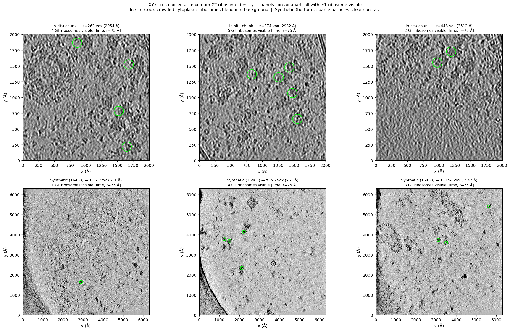
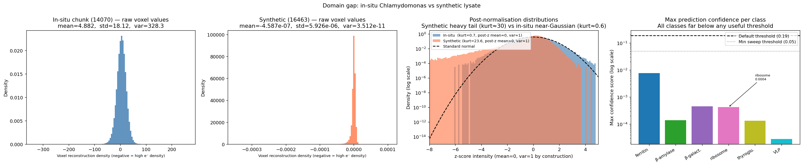
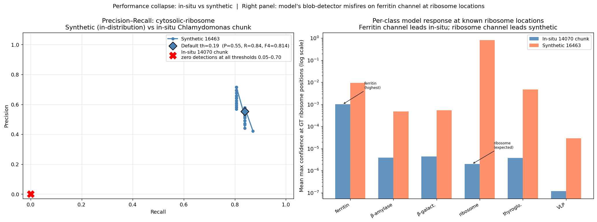
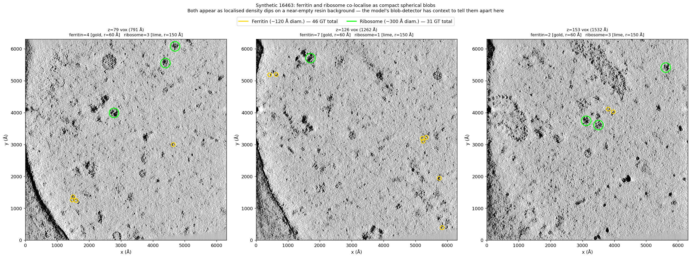
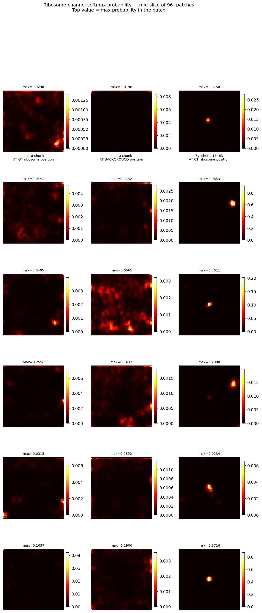

# Setup

## 1. Install uv

```bash
curl -LsSf https://astral.sh/uv/install.sh | sh
source ~/.bashrc
```

## 2. Create and activate a virtual environment

```bash
uv venv .venv --python 3.11
source .venv/bin/activate
```

## 3. Install TopCUP

The original TopCUP repo hard-codes CUDA in two places. Use the fork below,
which fixes that:

```bash
uv pip install "git+https://github.com/aarjunsrinivasan/czii_cryoet_mlchallenge_winning_models.git"
```

To use the official GPU build instead:

```bash
uv pip install topcup
```

## 4. Install matplotlib

```bash
uv pip install matplotlib
```

`matplotlib` is used by the figure scripts and is not pulled in by TopCUP.

## 5. End-to-end run

Two convenience scripts run all tasks in order:

```bash
./run_all.sh          # GPU machine — runs full inference
./run_cpu_test.sh     # CPU / no-GPU test — sets CUDA_VISIBLE_DEVICES="" so torch falls back to CPU
```

Both scripts handle setup (uv, venv, packages) with skip-if-already-done guards and then execute Tasks 2a → 2b → 2c in sequence.

**Output behaviour:** raw predictions (`val_pred_df_seed.csv`) are skipped if already present; metric CSVs and figures are always regenerated and will overwrite any saved copies. To force a full re-run from scratch, delete `output/` before running.

**Custom paths:** each task script accepts `--output-dir`, `--copick-config`, `--checkpoint-dir`, and other flags — run `python <script>.py --help` to see all options.

---

## Task 2a — Data Download

### Run IDs and data summary

| Role | Run ID | Dataset | Voxel size | Shape (Z × Y × X) | Ribosome annotations |
|---|---|---|---|---|---|
| In-distribution sanity check | **16463** (TS_5_4) | 10440 / dep. 10310 — CZII synthetic lysate | 10.012 Å | 184 × 630 × 630 | **31** |
| Held-out evaluation | **14070** (01122021_BrnoKrios…) | 10301 / dep. 10300 — Chlamydomonas in-situ | 7.84 Å | 512 × 1024 × 1024 | **202** |

Total download size: ~2.5 GB.

### How to reproduce

```bash
# Use default (./data/)
python download_data.py

# Use a custom location
python download_data.py --data-dir /path/to/my/data
```

This script:
1. Downloads each tomogram as OME-Zarr via `cryoet_data_portal.Tomogram.download_omezarr()`.
2. Fetches all ground-truth picks via `copick.from_czcdp_datasets()` and serialises them as JSON.
3. Writes a filesystem copick config at `data/copick_config_fs.json` that points at the local files, so subsequent inference runs read from disk rather than streaming from S3.

The copick config lists particles in the same positional order as the phantom
training dataset, which is what determines the channel mapping in the pretrained
checkpoint (channel assignment is positional, not name-based). The names used
here follow the evaluation dataset's (10301) convention and differ from the
phantom training names in three cases:

| Position (channel) | Phantom training name | Evaluation dataset name (used here) |
|---|---|---|
| 0 | `apo-ferritin` | `ferritin-complex` |
| 1 | `beta-amylase` | `beta-amylase` |
| 2 | `beta-galactosidase` | `beta-galactosidase` |
| 3 | `ribosome` | `cytosolic-ribosome` |
| 4 | `thyroglobulin` | `thyroglobulin` |
| 5 | `virus-like-particle` | `virus-like-capsid` |

This ordering was confirmed empirically via cross-evaluation during Task 2b development.

---

## Task 2b — Inference and Quality Assessment on Synthetic Data

### How to run

```bash
python run_inference_2b.py \
  --copick-config  data/copick_config_fs.json \
  --output-dir     output/inference_2b \
  --checkpoint-dir checkpoints \
  --run-id         16463 \
  --pixelsize      10.012 \
  --tomo-type      wbp-denoised-denoiset-ctfdeconv \
  --batch-size     1        # increase for faster GPU inference; default 1
```

The checkpoint (`topcup_phantom_24_tomograms.ckpt`) is downloaded automatically
from Hugging Face on first run.

### Inference-time hyperparameters

**Confidence threshold — 0.19 for `cytosolic-ribosome` (default); sweep-best is 0.05**
The default of 0.19 comes from the phantom training config (grid-searched by
the original authors on their held-out validation set). On run 16463 the
threshold sweep found **0.05** as the strict F4 maximum (F4 = 0.820, 27 TP,
37 FP, 4 FN), vs 0.814 at 0.19 (26 TP, 21 FP, 5 FN). The gap is marginal
(ΔF4 = 0.006) and the lower threshold adds 16 extra false positives to gain
one true positive. **0.19 is used as the default**; 0.05 is reported as the
sweep-best for completeness.

**NMS radius — `int(0.5 × particle_radius / pixelsize)` → 7 voxels for ribosome**
`int(0.5 × 150 Å / 10.012 Å/vox) = int(7.49) = 7`.
Suppresses duplicate detections of the same physical particle. Half-radius
spacing is the tightest physically meaningful separation: two ribosomes cannot
overlap by more than their radius.

**Sliding window — 96³ voxels, 21 % overlap (MONAI default)**
96 vox ≈ 961 Å ≈ 3× ribosome diameter, giving the U-Net enough context around
each tile. The 21 % overlap averages out tile-edge artefacts.

**Test-time augmentation — original + full (z, y, x) flip, averaged**
Cheap symmetry augmentation; the model is approximately permutation-symmetric
in x/y/z, so flipping costs one extra forward pass but reduces variance.

**Evaluation matching radius — 0.5 × particle_radius (Å)**
Follows the CZII competition protocol. A predicted centre must fall within half
a particle radius of the GT annotation to count as a true positive.

### Quality metrics

**Detection: Precision, Recall, F_β (β = 4)**
β = 4 heavily weights recall over precision, matching the biological priority:
missing a particle is worse than one false positive in a discovery setting.
Reported at both the default threshold and the F4-maximising threshold from
the P/R sweep.

**Localization: mean Euclidean distance of TP matches (Å)**
Captures centering accuracy independently of the TP/FP/FN binary decision.
A model can score high F4 while still placing detections systematically off-
centre; this metric surfaces that.

**P/R curve + AUC-PR (Area Under the Precision-Recall Curve)**
Sweeps thresholds 0.05–0.70 to give a threshold-independent summary of the
precision–recall trade-off. AUC-PR is computed per class so classes with zero
ground-truth annotations do not inflate the aggregate.

### Results — run 16463 (synthetic, in-distribution)

#### Per-class metrics at default thresholds

| Class | Threshold | n_GT | TP | FP | FN | Precision | Recall | F4 | Mean TP dist (Å) |
|---|---|---|---|---|---|---|---|---|---|
| ferritin-complex | 0.16 | 46 | 41 | 244 | 5 | 0.144 | 0.891 | 0.683 | 18.9 |
| beta-amylase | 0.25 | 8 | 3 | 61 | 5 | 0.047 | 0.375 | 0.266 | 26.2 |
| beta-galactosidase | 0.13 | 10 | 5 | 71 | 5 | 0.066 | 0.500 | 0.360 | 18.1 |
| **cytosolic-ribosome** | **0.19** | **31** | **26** | **21** | **5** | **0.553** | **0.839** | **0.814** | **24.9** |
| thyroglobulin | 0.18 | 30 | 24 | 48 | 6 | 0.333 | 0.800 | 0.739 | 27.8 |
| virus-like-capsid | 0.50 | 11 | 11 | 0 | 0 | 1.000 | 1.000 | 1.000 | 20.4 |

#### Ribosome: default threshold vs sweep-best

| | Threshold | TP | FP | FN | Precision | Recall | F4 | Mean TP dist (Å) |
|---|---|---|---|---|---|---|---|---|
| Default | 0.19 | 26 | 21 | 5 | 0.553 | 0.839 | 0.814 | 24.9 |
| Sweep-best (max-F4) | 0.05 | 27 | 37 | 4 | 0.422 | 0.871 | 0.820 | 25.1 |

The sweep-best threshold gains one TP at the cost of 16 extra FPs (ΔF4 = +0.006); the default is preferred.

#### Per-class AUC-PR + best-F4 (threshold sweep 0.05–0.70)

AUC-PR is the area under the precision–recall curve (trapezoidal rule, anchored at recall=0, precision=1). F4 at the optimal threshold is the more actionable operating-point metric; AUC-PR summarises the full curve independently of threshold choice.

| Class | n_GT | AUC-PR | Best F4 | @ threshold | Mean TP dist (Å) |
|---|---|---|---|---|---|
| ferritin-complex | 46 | 0.461 | 0.856 | 0.69 | 18.9 |
| beta-amylase | 8 | 0.140 | 0.313 | 0.52 | 26.2 |
| beta-galactosidase | 10 | 0.278 | 0.462 | 0.68 | 18.1 |
| **cytosolic-ribosome** | **31** | **0.674** | **0.820** | **0.05** | **25.1** |
| thyroglobulin | 30 | 0.529 | 0.751 | 0.26 | 27.8 |
| virus-like-capsid | 11 | 1.000 | 1.000 | 0.05 | 20.4 |

### Output files

| File | Contents |
|---|---|
| `output/inference_2b/val_pred_df_seed.csv` | Raw per-particle predictions with confidence scores |
| `output/inference_2b/results_default_threshold.csv` | Per-class P/R/F4/dist at default thresholds |
| `output/inference_2b/ribosome_pr_curve.csv` | Full P/R curve for `cytosolic-ribosome` |


## Task 2c — Held-out Inference and Failure Characterisation

### How to run

```bash
# Step 1: inference + metrics
python run_inference_2c.py \
  --copick-config  data/copick_config_fs.json \
  --output-dir     output/inference_2c \
  --checkpoint-dir checkpoints \
  --run-id         14070 \
  --pixelsize      7.84 \
  --tomo-type      wbp-denoised-ctfdeconv \
  --gt-user-id     data-portal \
  --results-2b     output/inference_2b/results_default_threshold.csv

# Step 2: diagnostic figures (domain gap, slice comparison, class confusion, PR curve, ferritin viz)
python generate_figures_2c.py

# Step 3: model-output evidence figures (loads the model; ~20 patch forward passes)
python visualize_model_output_2c.py
```

`run_inference_2c.py` extracts the chunk (x=160, y=752, 256×256, full z), builds a chunk-local copick config with coordinate-shifted GT picks, runs inference with the same checkpoint as Task 2b, and saves the metric CSVs. The two figure scripts read from the saved outputs and do not re-run inference.

### Results — chunk of run 14070 (in-situ Chlamydomonas)

#### Direct comparison: cytosolic-ribosome

| Dataset | n_GT | Threshold | TP | FP | FN | Precision | Recall | F4 | Mean TP dist (Å) | AUC-PR |
|---|---|---|---|---|---|---|---|---|---|---|
| Synthetic 16463 (2b) | 31 | 0.19 | 26 | 21 | 5 | 0.553 | 0.839 | 0.814 | 24.9 | 0.674 |
| **In-situ 14070 chunk (2c)** | **56** | **0.19** | **0** | **0** | **56** | **0.000** | **0.000** | **0.000** | — | **0.000** |

The model produces **zero ribosome detections** across the full threshold sweep 0.05–0.70. The maximum ribosome confidence score anywhere in the chunk is **0.0004** — two orders of magnitude below the lowest threshold tested.

### Failure analysis

#### 1. Visual inspection — what ribosomes look like in each setting

The most direct evidence of the domain gap: the z-slices below are picked at the **highest GT ribosome density**, spread across the volume (separation relaxed progressively until all three panels have ≥1 ribosome visible). Each lime circle marks a GT ribosome centred within ±3 voxels of the shown slice; the voxel z-coordinate and Ångström depth are printed in each panel title.



*Top row (in-situ chunk, run 14070): the three panels are the ribosome-richest sections; z-coordinates are printed in each title. Ribosomes are embedded in dense, continuous cytoplasm — their density signature is indistinguishable from the surrounding material at a glance. Bottom row (synthetic, run 16463): the same selection criterion applied to the synthetic volume. Particles are sparse, well-separated, and sit on a nearly empty featureless background — the visual contrast that the model was trained to detect.*

This difference already explains the failure qualitatively: in-situ ribosomes do not produce the localised, high-contrast density blobs the model learned to trigger on.

#### 2. Statistical distribution mismatch

Both datasets are z-score normalised before the model (`NormalizeIntensityd`). The normalization is **per whole-volume**: MONAI computes mean and std from all voxels in the input tomogram (or chunk) and divides by those — it does not use fixed training-set statistics, and it does not normalize per-patch. Sliding-window inference extracts 96³ patches from the already-normalized volume. After whole-volume normalization the volume-level mean = 0 and variance = 1 by construction for any input — those first two moments are trivially equal and tell us nothing. What differs is the *shape* of the distribution (kurtosis, skewness), which is invariant to z-scoring.

**Scope of the comparison:** the in-situ statistics are computed from the **256×256×512 chunk** (the exact volume fed to the model at inference), not the full 512×1024×1024 14070 tomogram. The synthetic statistics are from the full 16463 tomogram. This is the correct comparison for explaining inference failure — it reflects what the model literally receives. The full in-situ tomogram would likely have kurtosis even closer to Gaussian (denser cytoplasm), so the domain gap reported here is a lower bound.

| Property | In-situ chunk (14070) | Synthetic (16463) |
|---|---|---|
| **Raw mean** | 4.882 | −4.59 × 10⁻⁷ |
| **Raw std (var)** | 18.12 (328.3) | 5.93 × 10⁻⁶ (3.51 × 10⁻¹¹) |
| **Post z-score mean** (whole-volume) | ≈ 0 (by construction) | ≈ 0 (by construction) |
| **Post z-score variance** (whole-volume) | ≈ 1 (by construction) | ≈ 1 (by construction) |
| **Post z-score kurtosis (excess)** | **0.7** | **30.4** |
| **Post z-score skewness** | −0.13 | −3.00 |

Synthetic training data has kurtosis ≈ 30: mostly empty featureless background with a few dense, well-separated particles creating extreme negative-tail outliers. The model learned to detect those outlier signatures. The in-situ chunk has kurtosis ≈ 0.7 (essentially Gaussian): crowded cytoplasm fills the volume uniformly, erasing the outlier peaks the model relies on. Every voxel looks like background to the model.



*Panels left to right: (1) In-situ raw reconstruction density — negative values are physically expected in CTF-corrected WBP tomograms (high electron density ↔ negative voxel values), mean/std/var shown. (2) Synthetic raw reconstruction density — separate panel on its own scale (~6 orders of magnitude different from in-situ). (3) z-score normalised distributions on log scale — synthetic heavy tail extends to −7σ, in-situ is compact and near-Gaussian. (4) Max prediction confidence per class — all six classes explicitly shown with short labels; ribosome bar annotated with its value (~0.0004), two orders of magnitude below the lowest threshold.*

#### 3. Class confusion and precision–recall collapse

The model does not fail uniformly across all output channels at ribosome locations. For each GT ribosome position, the maximum confidence of each class's NMS peaks within 75 Å (the CZII matching radius) was computed and averaged across all 56 GT ribosomes in the chunk (in-situ) and all 31 in run 16463 (synthetic):

| Channel | Mean max-conf at GT ribosomes — in-situ | Mean max-conf at GT ribosomes — synthetic |
|---|---|---|
| ferritin-complex | **~10⁻³** (highest) | ~10⁻² |
| cytosolic-ribosome | ~10⁻⁶ | **~1.0** (correct) |
| all other classes | ~10⁻⁵–10⁻⁶ | ~10⁻³–10⁻⁴ |

At known ribosome locations in-situ, the ferritin channel produces a response **~500× stronger** than the ribosome channel (mean max-conf 1.0×10⁻³ vs 2.0×10⁻⁶). The model's blob detector is misfiring onto the wrong class rather than suppressing uniformly. Both ferritin (~120 Å diameter) and ribosome (~300 Å diameter) are compact spherical density blobs — in the sparse synthetic setting the model can distinguish them by size and contrast; in the uniform in-situ cytoplasm the weak residual signal more closely resembles the smaller ferritin signature.



*Left: Precision–Recall curves for cytosolic-ribosome. Synthetic 16463 achieves a working operating point (F4=0.814 at th=0.19); the in-situ 14070 chunk collapses to a single red ✕ at the origin — zero detections at every threshold from 0.05 to 0.70. Right: mean max confidence of each class at GT ribosome positions. In synthetic (coral) the ribosome bar correctly dominates at ~1.0; in-situ (blue) the ferritin bar leads at ~10⁻³, with ribosome ~500× lower at ~2×10⁻⁶.*

The figure below shows both particle species in the synthetic volume, confirming they share the same compact-blob appearance. In this low-background setting the model has enough contrast to separate them by size; that contrast disappears entirely in the crowded in-situ cytoplasm.



*Synthetic 16463 — three z-slices chosen to maximise co-visibility of both species (separation ≥ 15 % of volume depth). Gold circles: ferritin GT centres (r=60 Å, ~120 Å diameter); lime circles: ribosome GT centres (r=150 Å, ~300 Å diameter). On the near-empty featureless background both produce clear, isolated density dips whose size difference is the primary discriminating feature.*

#### 4. Patch-level softmax: GT positions vs background are indistinguishable in-situ

To directly probe what the model "sees" at a known ribosome location, individual 96³ patches were extracted at GT ribosome centres and at random background positions (>300 Å from any GT), pre-normalised identically to full-volume inference, and passed through the model. The mid-slice of the ribosome-channel softmax probability map is shown for each:



*Three columns: (left) in-situ chunk patches centred on GT ribosomes; (middle) in-situ chunk patches at random background positions; (right) synthetic 16463 patches centred on GT ribosomes. Colour scale = ribosome-channel softmax probability; top value = patch maximum. In-situ GT patches (left) and in-situ background patches (middle) are visually and numerically indistinguishable — both max out at ~0.002–0.16 with no localised bright structure. Synthetic GT patches (right) show at least one patch with a clear localised blob at max ≈ 0.78; the rest range from 0.003 to 0.12 but are spatially structured. The model cannot tell a ribosome location from random cytoplasm in the in-situ setting.*

This is the most direct evidence of the domain gap: the model's ribosome detector produces the same featureless, near-zero response at actual ribosome positions as it does at empty cytoplasm. There is no localised "hot spot" to threshold. Across the full sliding-window inference, 1,209 NMS-surviving ribosome candidates are produced before any threshold is applied — every one falls below 0.002 confidence, and their spatial distribution is uncorrelated with GT positions, ruling out the hypothesis that the model is "almost finding" ribosomes but undershooting the threshold.

### Differences between synthetic and in-situ settings

| Factor | Synthetic lysate (training) | In-situ Chlamydomonas (test) |
|---|---|---|
| Cellular context | Sparse, isolated particles in featureless simulated medium | Crowded cytoplasm; particles densely packed with no clear background |
| Intensity distribution | Sparse background + extreme outlier peaks; kurtosis ≈ 30 | Dense, near-Gaussian; kurtosis ≈ 0.7 |
| Acquisition | Computationally simulated | Real cryo-ET: CTF artefacts, beam-induced motion |
| Voxel size | 10.012 Å | 7.84 Å |
| Background complexity | Empty medium | Membranes, organelles, cytoskeletal elements |

### Output files

| File | Contents |
|---|---|
| `output/inference_2c/val_pred_df_seed.csv` | Raw predictions (all classes, all confidence levels) |
| `output/inference_2c/results_default_threshold.csv` | Ribosome metrics at default threshold (0.19) |
| `output/inference_2c/ribosome_pr_curve.csv` | Full P/R curve sweep 0.05–0.70 |
| `output/inference_2c/domain_gap_analysis.png` | 4-panel: in-situ raw intensity (own scale, mean/std in title), synthetic raw intensity (own scale), z-score normalised overlay (log), per-class max confidence with ribosome annotated |
| `output/inference_2c/slice_comparison.png` | XY slices at ribosome-richest z-depths (all panels guaranteed ≥1 ribosome visible) with GT overlays — in-situ vs synthetic |
| `output/inference_2c/ferritin_ribosome_synthetic.png` | Synthetic 16463 slices with ferritin (gold, r=60 Å) and ribosome (lime, r=150 Å) GT overlaid — shows both as compact blobs on resin background |
| `output/inference_2c/performance_summary.png` | Left: PR curve overlay (synthetic working curve vs in-situ collapse to origin). Right: per-class mean max-confidence at GT ribosome positions — ferritin channel leads in-situ, ribosome channel leads synthetic |
| `output/inference_2c/ribosome_patch_comparison.png` | 96³ patch ribosome-channel softmax mid-slices: in-situ GT positions vs in-situ background vs synthetic GT positions — GT and background patches are indistinguishable in-situ |

---

## Task 2d — Proposal: Improving Performance on Chlamydomonas

The Task 2c results identify three quantified failure modes; the proposals below treat each as a working hypothesis and propose concrete interventions to test them.

### Observed failure modes (from Task 2c)

1. **Distribution mismatch** — post-z-score kurtosis 30.4 (synthetic) vs 0.7 (in-situ). The model appears to act as an outlier detector; dense cytoplasm may be erasing the sparse high-contrast signatures it learned on.
2. **Complete detection collapse** — F4 = 0.000 across all thresholds 0.05–0.70; max ribosome confidence = 0.0004. GT-centred and background patches produce the same ribosome-channel response (max ≈ 0.002–0.16 in both cases).
3. **Class confusion** — ferritin channel fires ≈500× stronger than ribosome at GT ribosome positions (≈10⁻³ vs ≈2×10⁻⁶). One likely cause: both are compact blobs and the model may have learned to separate them by contrast rather than size.

**Suggested order:** try section 3 (denoising swap) first as a zero-label baseline; if ribosome-channel confidence at GT positions does not improve, proceed to section 1 (augmentation); section 2 (fine-tuning) requires section 1's adapted model as its starting point; section 4 (CryoSiam ranking) can run in parallel with section 2 to prioritise the annotation queue.

### 1. Augment synthetic training toward the in-situ regime

**Background copy-paste mixing.** Extract background sub-volumes from run 14070 (regions >300 Å from any GT annotation) and composite synthetic ribosome density into them:

```
composite = α * synthetic_particle + (1 − α) * insitu_background_crop,  α ~ Uniform(0.7, 1.0)
```

In-situ background crops have kurtosis ≈ 0.7 by construction; this targets the distribution gap without re-simulating data. Hard negatives should be sampled from ferritin-channel NMS peaks in the in-situ volume, given the observed class confusion.

**CTF and missing-wedge augmentation.** The 22% voxel-size difference (10.012 Å → 7.84 Å) and real-acquisition CTF are secondary contributors to the appearance mismatch; the dominant gap is the cytoplasm crowding (kurtosis 30.4 → 0.7), which this augmentation does not address — apply background copy-paste mixing first.

*Voxel rescaling.* The factor 10.012 / 7.84 = 1.278 is exact given the two known voxel sizes. To produce a 96³ patch at the in-situ apparent resolution, extract a ≈75³ sub-volume from the synthetic tomogram and zoom it by 1.278 (`scipy.ndimage.zoom`); do not zoom an already-96³ patch and crop back, as that discards context voxels.

*Missing-wedge mask.* Apply a wedge-shaped zero mask in Fourier space (`torch.fft.fftn` → zero wedge → `torch.fft.ifftn`). The half-angle of the missing wedge is dataset-specific and must be read from the 14070 tilt series metadata (STAR or MDOC file): `half_angle = 90° − max_tilt`. A ±30° wedge corresponds to a ±60° maximum tilt, which is a common acquisition range, but this should be verified before use rather than assumed.

*CTF simulation* (e.g. Parakeet) is possible in principle but requires per-tilt defocus/dose metadata not present in the downloaded data; treat as a stretch goal after the above augmentations have been validated.

### 2. Fine-tune on a small human-reviewed in-situ set

Augmentation alone may not be sufficient; real in-situ examples are likely needed to address failure modes 2 and 3. Split run 14070 by z-slab (not random — nearby ribosomes share local context and would leak across a random split). Fine-tune the TopCUP decoder/head first; unfreeze earlier layers only if held-out F4 improves. Oversample hard negatives to counteract the inherent particle/background class imbalance in any sparse-particle setting; in this specific case the class confusion analysis (failure mode 3) identifies ferritin-channel NMS peaks as the highest-priority hard negative source.

Annotation loop:

*Bootstrap (iteration 0):* The loop assumes the augmentation-adapted model from section 1 already provides non-trivial ribosome candidates. If augmentation alone still leaves confidence near zero everywhere, seed the initial candidate list via template matching — e.g. [GAPSTOP TM](https://gitlab.mpcdf.mpg.de/bturo/gapstop_tm) against an 80S ribosome reference from EMDB (e.g. EMD-2275, a cytosolic 80S; verify organism match and resolution before use). Template-match scores are noisy and cannot substitute for GT (as the task specifies), but they provide a spatially plausible shortlist that reduces the cold-start annotation burden before the model has seen any in-situ positives.

1. Run adapted model at low threshold → candidate centers.
2. Review in copick/napari; accept, reject, or adjust.
3. Add accepted as positives, high-confidence rejects as hard negatives.
4. Retrain; repeat until held-out F4 and annotation burden plateau.

### 3. Denoising pre-processing

The in-situ input ("wbp-denoised-ctfdeconv") has already been denoised, but the specific denoiser may differ from what TopCUP trained on. Testing alternatives is a zero-label intervention. Selection criterion: whichever denoiser raises ribosome-channel confidence at held-out GT positions (measured with the patch-probing protocol from Task 2c).

- **IsoNet** ([github.com/IsoNet-cryoET/IsoNet](https://github.com/IsoNet-cryoET/IsoNet)): self-supervised on already-reconstructed tomograms, reported to improve picking on in-situ cellular data (Liu et al., Nature Comms 2022). Note: missing-wedge infilling may introduce hallucinations — use for picking only, not structure determination.
- **TOPAZ-Denoise** ([github.com/tbepler/topaz](https://github.com/tbepler/topaz), `pip install topaz-em`): standalone, pre-trained 3D models, no retraining needed (Bepler et al., Nature Comms 2020).

### 4. Self-supervised subtomogram embedding for candidate prioritization

[CryoSiam](https://github.com/frosinastojanovska/cryosiam) provides self-supervised subtomogram embeddings trained on raw density patterns without particle labels. Its value here is precisely because model confidence is uniformly near-zero and spatially uninformative (Task 2c): confidence-based candidate ranking has collapsed entirely, but raw appearance may still carry shape signal that the model's softmax has lost. Train CryoSiam on the in-situ tomogram itself; use GT ribosome subtomograms from run 16463 as embedding anchors to rank the 1,209 NMS-surviving candidates by embedding distance. This shortlists the annotation workload for step 2 of the loop above — a human reviews the top-ranked candidates first rather than sampling randomly from 1,209 positions.

**Caveat:** domain gap may also affect the embedding space; CryoSiam was developed on purified single-particle data, not crowded cytoplasm. Validate the ranking before relying on it: if the embedding-ranked top-100 candidates overlap GT positions at a rate no better than random, fall back to the template-matching bootstrap (iteration 0) instead.

### 5. Evaluation

**Same detection metrics as Tasks 2b/2c — tracked per annotation-loop iteration.** Report precision, recall, F4, and mean localization distance on the spatially held-out z-slab after each round of retraining. This makes progress visible and shows when adding more labels stops improving performance — the point at which the annotation loop can stop.

**Human review cost per confirmed ribosome.** At a fixed recall level, count how many candidate positions a human must inspect to find one genuine ribosome. This measures whether the candidate-ranking improvements (sections 2 and 4) are actually reducing manual work, not just moving F4. A method that halves review time at the same recall is more useful than one that improves F4 by a few points while reviewing the same number of positions.

**Visual particle average as a contamination check.** Crop small sub-volumes centred on every detected position and average them together. If the picks are mostly real ribosomes, the average looks like a recognizable ribosome shape. If ferritin detections are contaminating the result — the class confusion identified in Task 2c — the average blurs toward something in between or looks like nothing. This is a low-cost visual check that does not depend on any confidence threshold and directly shows whether failure mode 3 (class confusion) has been resolved.